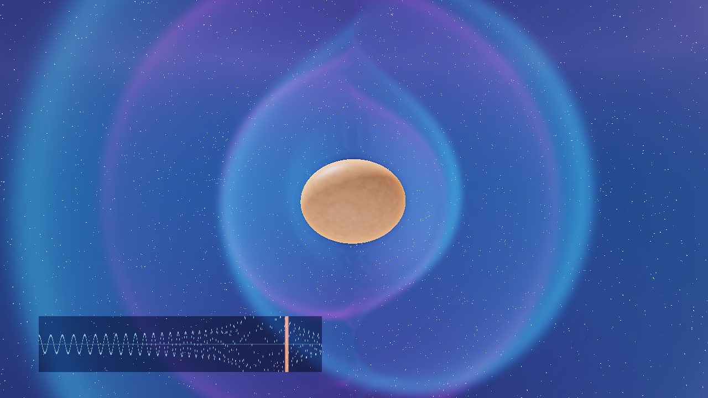

# Binary Neutron Star ShaderToy

`BNS_CAUSAL_REPAIR.glsl` is a complete, single-pass ShaderToy `Image` shader.
It contains its reduced physical model directly in GLSL and does not connect
to Python, load a checkpoint, or require a texture after publication.



## Publish it

1. Open [ShaderToy's new-shader page](https://www.shadertoy.com/new).
2. Select the `Image` tab and replace its contents with everything in
   `BNS_CAUSAL_REPAIR.glsl`.
3. Compile, enter fullscreen, and save the shader to obtain a shareable page.

The animation loops every 32 seconds. Drag with the mouse held down to orbit
the camera. A blue waveform trace at the lower left shows the reduced strain;
the orange cursor marks the current point in the inspiral/merger loop.

For a local WebGL preview, serve the folder (browsers block shader loading from
raw `file:` pages) and open the displayed address:

```powershell
python -m http.server 8877 --directory shadertoy
```

Then visit `http://localhost:8877/preview.html`. The preview uses the same
ShaderToy-compatible uniforms and shader source as the published version.
Append a time in seconds, such as `preview.html?time=23.5`, to freeze the local
preview at a particular point for screenshots or visual regression checks.
Select another generated file with, for example,
`preview.html?shader=BNS_PROMPT_COLLAPSE.glsl&time=29`.

## What is actually being calculated

The offline Python model and its GLSL translation use geometric units

```text
G = c = M_total = 1.
```

The inspiral follows the leading adiabatic, quasi-circular quadrupole equations

```text
dr/dt = -(64/5) eta/r^3
Omega = r^(-3/2)
phi(r) = [r0^(5/2) - r^(5/2)]/(32 eta).
```

The neutron-star radii are `R_i=m_i/C_i`. Their equilibrium quadrupolar tidal
bulges scale as

```text
epsilon_i = (3/2) k2_i (m_j/m_i) (R_i/r)^3.
```

The wave display uses the leading transverse quadrupole amplitude
`A=4 eta/(distance*r)` with twice the orbital phase. Ray directions are bent
by a softened two-body potential and perturbed by an amplified transverse wave
field. This produces a physically motivated lensing visualization, not a
numerical integration of exact null geodesics through a CCZ4 spacetime.
The luminous wave ribbons use the same evolving source phase and frequency but
compress their displayed wavelength by a factor of six; otherwise the camera
volume contains too little early-inspiral phase for the radiation to be seen.

After merger, the waveform switches continuously to an explicit damped
`(l,m)=(2,2)` fluid mode. The default `2.7 M_sun` system uses `f2=3.0 kHz`,
equivalent to `omega_22 M=0.2507`, and displays the first 4 ms (12 cycles) with
a 2.5 ms damping time. The remnant bar rotates at half the `m=2` wave phase.

At contact, the script smoothly changes to a rotating ellipsoidal remnant with
a damped bar deformation. That bridge is phenomenological. It is deliberately
isolated in the model so a future CCZ4 `Psi4(l=2,m=2)` fit can replace it without
rewriting the renderer.

The display-time map preserves both phase and angular velocity at first
contact. It then decelerates the coalescing pair continuously to the ringdown
bar-mode rate, producing roughly three visible turns between contact and the
completed remnant transition. Physical post-merger time still controls the
damping envelope; it is not incorrectly stretched into the orbital clock.

## Scientific qualification

| Feature | Status |
|---|---|
| Inspiral separation and phase | Leading-order post-Newtonian/quadrupole approximation |
| Stellar radii | Compactness-based |
| Tidal deformation | Equilibrium Love-number approximation; visually amplified 7x |
| Gravitational-wave polarization | Leading quadrupolar phase and angular structure |
| Visible spacetime ripples | Strongly amplified, 6x wavelength-compressed rendering layer |
| Gravitational lensing | Softened weak-field ray deflection |
| Contact, merger, remnant | Smooth phenomenological visualization bridge |
| Purple causal-repair field | Illustrative massive/dispersive auxiliary layer |

The causal-repair layer is **not a prediction from a BNS Production33
campaign**. It is colored separately and marked illustrative in both the GLSL
header and JSON manifest. Generate a GR-only version with
`--repair-strength 0`.

## Regenerate or customize it

From the repository root:

```powershell
python shadertoy/build_bns_shader.py
```

Useful variants:

```powershell
# GR-only publication build
python shadertoy/build_bns_shader.py --repair-strength 0 --output shadertoy/BNS_GR.glsl

# Unequal masses and high rendering quality
python shadertoy/build_bns_shader.py --mass-ratio 0.8 --quality 2

# Faster loop and weaker lensing
python shadertoy/build_bns_shader.py --animation-seconds 20 --lensing-gain 0.5

# A lower-frequency post-merger EOS example
python shadertoy/build_bns_shader.py --postmerger-f2-khz 2.6
```

The generator writes a same-named `.json` manifest containing every physical
parameter, derived mass/radius/time quantity, and qualification statement.
Keep that file with screenshots or publication notes so the visualization is
reproducible.

At the top of the generated GLSL, the following switches can be changed before
pasting it into ShaderToy:

```glsl
#define CR_QUALITY 1          // 0 fast, 1 default, 2 high
#define SHOW_WAVE_FIELD 1
#define SHOW_REPAIR_FIELD 1
#define SHOW_DIAGNOSTIC 1
#define SHOW_HORIZON_WIREFRAME 1
#define PROMPT_COLLAPSE_BRANCH 0
```

`PROMPT_COLLAPSE_BRANCH` remains off in the default hypermassive-neutron-star
ending. Enable the analytic collapse preview with:

```powershell
python shadertoy/build_bns_shader.py --prompt-collapse `
  --output shadertoy/BNS_PROMPT_COLLAPSE.glsl
```

At `HORIZON_FORMATION_U` the remnant contracts into a dark oblate candidate
surface carrying an emissive latitude/longitude wireframe. This is explicitly
an analytic preview, not a solver-detected MOTS. A true horizon will replace
its radius and shape only after a qualified collapse campaign supplies the
surface coefficients.

Qualified non-axisymmetric solver data can be embedded with `--mots-bake`.
See [`MOTS_BAKE_SPEC.md`](MOTS_BAKE_SPEC.md) for the packet format, expansion
response semantics, and the campaign gates that prevent an analytic surface
from being mislabeled as a detected horizon.

Two solver-fed examples are checked in:

- `BNS_BL_BIFURCATION_OVERLAY.glsl` renders the converged direct-surface
  Brill-Lindquist common branch through `ell=16`, including the `d=0.766`
  surface. Its wireframe changes from cyan toward gold as the physical-normal
  principal eigenvalue approaches zero.
- `BNS_CCZ4_PUNCTURE_PILOT_OVERLAY.glsl` renders actual evolving common-outer
  surfaces from the N=32 puncture trajectory, but is explicitly marked
  under-resolved because those observations fail the Cartesian sign gate.

These are vacuum horizon-calibration overlays on the BNS presentation layer,
not claims that the displayed neutron-star bridge produced those surfaces.

## Future solver-calibrated version

The solver already provides finite-radius `Psi4` extraction and its spherical
harmonic `l=2` modes. Once a quasi-circular BNS campaign is available, the
upgrade path is:

1. extrapolate the complex `Psi4(2,2)` mode across extraction radii;
2. align and integrate it to strain with drift control;
3. fit amplitude and phase residuals against this analytic backbone;
4. bake those compact fit coefficients into the same GLSL timeline;
5. replace the illustrative repair layer with independently extracted Proca
   and carrier-current multipoles.

That will retain the one-file ShaderToy result while moving the source history
from an approximation to solver-calibrated dynamics.
